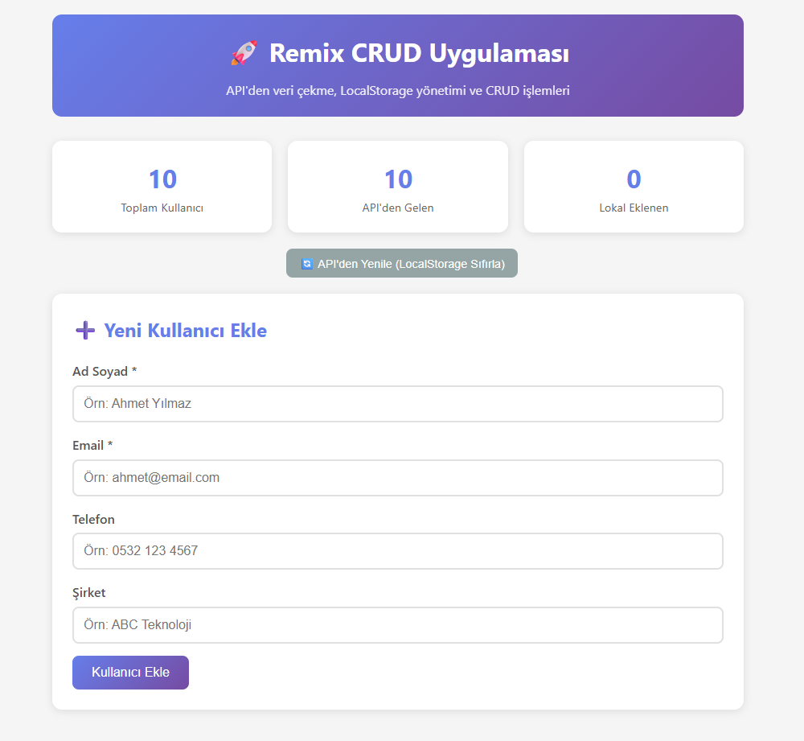
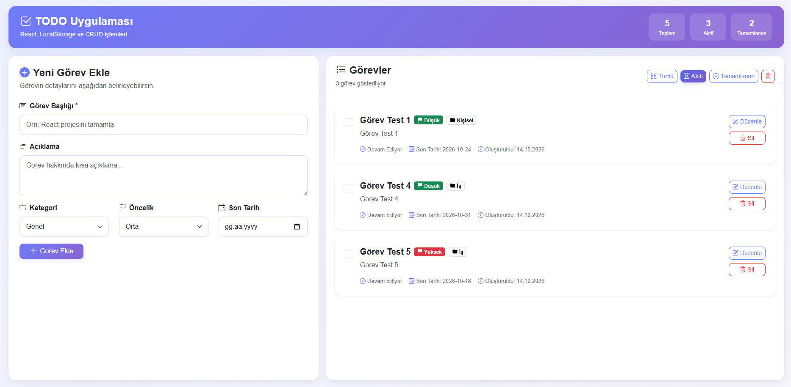
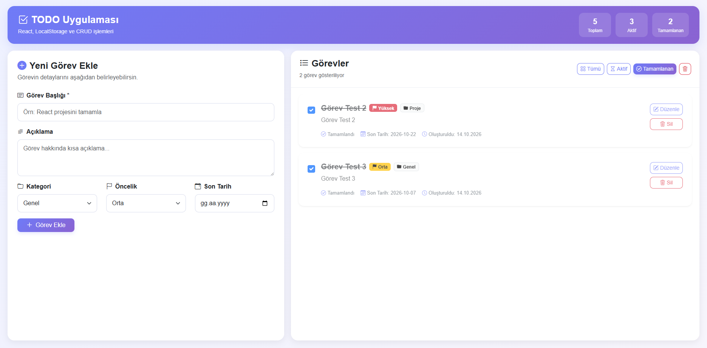

# React TODO Uygulaması

React ve Vite kullanılarak geliştirilmiş basit bir görev yönetim uygulamasıdır.

Uygulama içerisinde görev ekleme, listeleme, güncelleme, silme ve tamamlandı olarak işaretleme işlemleri yapılabilmektedir. Görevler tarayıcının LocalStorage alanında saklanır.

## Kullanılan Teknolojiler

- React
- Vite
- JavaScript
- Bootstrap 5
- Bootstrap Icons
- LocalStorage

## Özellikler

- Yeni görev ekleme
- Görev listeleme
- Görev güncelleme
- Görev silme
- Görevi tamamlandı olarak işaretleme
- Tüm / Aktif / Tamamlanan filtreleri
- Görev kategorisi
- Görev önceliği
- Son tarih belirleme
- Görev istatistikleri
- LocalStorage ile kalıcı veri saklama
- Responsive tasarım
- Sabit iki kolonlu arayüz
- Görev listesinin kendi içinde scroll olması

## Kurulum

Projeyi klonlayın:

```bash
git clone https://github.com/nurguzay/todo.git
```

Proje klasörüne girin:

```bash
cd todo
```

Bağımlılıkları yükleyin:

```bash
npm install
```

Projeyi geliştirme modunda çalıştırın:

```bash
npm run dev
```

Uygulama varsayılan olarak:

```text
http://localhost:5173
```

adresinde çalışır.

Production build almak için:

```bash
npm run build
```

Production çıktısını yerelde test etmek için:

```bash
npm run preview
```

## Proje Yapısı

```text
todo/
├── docs/
│   └── screenshots/
│       ├── index.png
│       ├── actives.png
│       └── done.png
├── public/
├── src/
│   ├── components/
│   │   ├── TodoForm.jsx
│   │   └── TodoItem.jsx
│   ├── pages/
│   │   └── TodoPage.jsx
│   ├── App.jsx
│   ├── index.css
│   └── main.jsx
├── .gitignore
├── eslint.config.js
├── index.html
├── package-lock.json
├── package.json
├── README.md
└── vite.config.js
```

## CRUD İşlemleri

| İşlem | Açıklama |
|---|---|
| Create | Yeni görev ekleme |
| Read | Görevleri listeleme |
| Update | Mevcut görevi düzenleme |
| Delete | Görev silme |

## Veri Saklama

Görev verileri `LocalStorage` içerisinde saklanmaktadır.

Bu nedenle sayfa yenilense veya tarayıcı kapatılıp tekrar açılsa bile görevler korunur.

## Ekran Görüntüleri

### Ana Ekran



### Aktif Görevler



### Tamamlanan Görevler



## Canlı Demo

Canlı proje adresi:

```text
NETLIFY_VEYA_VERCEL_URL
```

## GitHub

Repository adresi:

```text
https://github.com/nurguzay/todo.git
```
